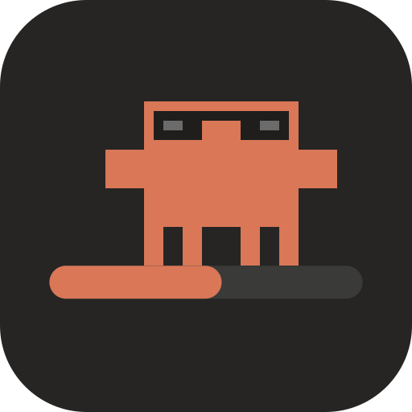
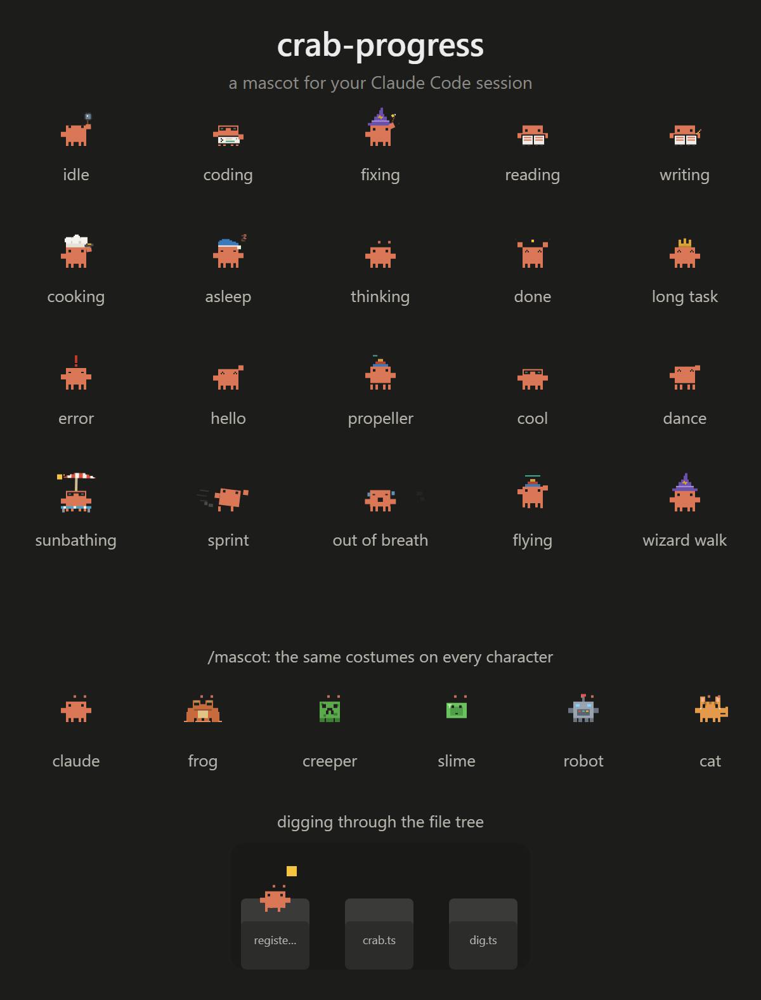

<div align="center">



# crab-progress

**A mascot for your [Claude Code](https://claude.com/claude-code) session.**
A progress bar he rides, [Token Optimizer](https://github.com/alexgreensh/token-optimizer)'s quality,
context, cache and usage marks in the same band, a panel for your subagents, a file tree he digs
through, and costumes for everything Claude does. He waves a question bubble when Claude needs you.




</div>

> Unofficial fan project. Not affiliated with or endorsed by Anthropic, Mojang or Microsoft.

## What you get

### A progress bar with a passenger
- A bar above the prompt that moves on its own during every turn and hits 100% when the turn ends.
  Use the `progress` tool or `TodoWrite` to set exact done/total instead.
- The mascot rides the head of the fill. When the bar jumps 12% or more he **sprints**, and when it
  stops he **pants**. A leap of 30% or more is too far to run, so he **gets in a car** and drives it.
  After the car he parks and climbs out; he never pants. If it stalls he idles instead of freezing.
- At 100% he **celebrates**, and how depends on the turn: out of the car after a drive, a medal after
  a sprint, a green-checked terminal after coding, a firework after fixing, a shut book after
  reading, a ticked page after writing. Every character has its own flourish (the frog hops, the
  creeper swells, the slime squishes, the robot shakes, the cat sways).
- If you also run the cache-tax / keepwarm status line and the prompt cache has gone **cold**, he is
  frozen in a cube of ice, shivering, until the next turn warms it up.
- His costume follows the task, picked by a tiny keyword classifier that runs locally (no model call,
  no network): wizard hat and wand for fixing, sunglasses and a terminal for coding, a book for
  reading, a chef's toque and a pan for long jobs, a nightcap after a while idle, a crown after a
  long task.
- Between costumes he digs the next one out of a belly pocket and puts it on where it belongs.
- With nothing to do he roams the bar: he walks, flies with a propeller cap, reads, waves, dances and
  sunbathes under an umbrella.

- **When Claude needs you** (a question, a plan to approve, a permission prompt) he stops, waves a
  claw and a gold question bubble bobs over his head, and the bar turns gold, until you answer.

### Token Optimizer in the same band
Merged from [token-optimizer](https://github.com/alexgreensh/token-optimizer)'s desktop bar and drawn
in the crab's style, under the progress row:
- One sentence about what matters now, with at most one button.
- Five marks with hover cards: quality grade, context, cache countdown, 5-hour and weekly usage.
- An unfold arrow for session time, tool calls, checkpoint and tokens saved, plus **Clean up**,
  **Start fresh**, **Keep warm** and **Full dashboard**.
- It needs Token Optimizer installed (it reads its data). Turn the rows off with
  `CRAB_OPTIMIZER_BAR=0` and start slim with `CRAB_OPTIMIZER_BAR_SIZE=slim` in your settings `env`;
  set `TOKEN_OPTIMIZER_STATUS_BAR=0` so Token Optimizer's own bar does not draw a second band.
- Idle sessions stand still and redraw rarely, and session switches do not wait on its reads.

### A subagents panel (`/agents-info`)
- Cost, tokens and time up top, then one row per subagent with model, effort, context use, cost,
  elapsed time and its own progress bar. Each row's mascot dresses for what that agent is doing and
  cheers, then idles, when it finishes.

### A file tree (`/filetree`)
- An IDE-style tree with git status that shimmers where Claude reads and writes. The desktop layout is
  roomier (two-line rows) and styled to match the rest of the mod.
- While files are being touched the crab works **inside the real rows**: a burrow strip opens under
  three of them, he dives into the file that was touched, throws things out until he finds a gem,
  pops up, jumps into another file and pokes his head out of a third. It is drawn in the tree's own
  grid, so it lines up with the rows and scrolls with them.

### Characters (`/mascot`)
`/mascot claude`, `frog`, `creeper`, `slime`, `robot` or `cat` (or `/frog`, `/creeper`, ...). Every
costume and animation works on every character, and your pick is remembered.

## Install

You need [Claude Code](https://claude.com/claude-code) with plugin support (built and tested on
**2.1.295**) and `git`. The steps are the same on every system.

### From inside Claude Code (all systems)

```text
/plugin marketplace add RyanWeera/crab-progress
/plugin install crab-progress@crab-progress
```

Then start a new session. To update later:

```text
/plugin marketplace update crab-progress
```

### From a terminal

<details open>
<summary><b>macOS</b></summary>

```bash
# Homebrew users: brew install git   (Xcode command line tools also include git)
claude plugin marketplace add RyanWeera/crab-progress
claude plugin install crab-progress@crab-progress
```

Run it without installing, straight from a clone:

```bash
git clone https://github.com/RyanWeera/crab-progress.git ~/crab-progress
claude --plugin-dir ~/crab-progress
```

The file tree uses `git`, `find` and `du`, which macOS already has. Quick Look preview uses `qlmanage`.
</details>

<details>
<summary><b>Linux</b></summary>

```bash
# Debian/Ubuntu: sudo apt install git     Fedora: sudo dnf install git     Arch: sudo pacman -S git
claude plugin marketplace add RyanWeera/crab-progress
claude plugin install crab-progress@crab-progress
```

Or from a clone:

```bash
git clone https://github.com/RyanWeera/crab-progress.git ~/crab-progress
claude --plugin-dir ~/crab-progress
```

The file tree uses `git`, `find` and `du`. Opening files uses your desktop's default handler.
</details>

<details>
<summary><b>Windows</b></summary>

```powershell
# winget install --id Git.Git   (Git for Windows supplies find, du and sh, which the file tree uses)
claude plugin marketplace add RyanWeera/crab-progress
claude plugin install crab-progress@crab-progress
```

Or from a clone:

```powershell
git clone https://github.com/RyanWeera/crab-progress.git $HOME\crab-progress
claude --plugin-dir $HOME\crab-progress
```
</details>

### If you already use the originals

This mod **includes** the `filetree` and `savvy-progress` mods and registers the same `/filetree` and
`/agents-info` commands. Remove the originals first so they don't fight:

```bash
claude plugin uninstall filetree
claude plugin uninstall savvy-progress
```

### Uninstall

```bash
claude plugin uninstall crab-progress@crab-progress
```

## Commands

| Command | What it does |
|---|---|
| `/mascot <name>` | Switch character: `claude`, `frog`, `creeper`, `slime`, `robot`, `cat`. `/mascot list` shows them. |
| `/frog` `/creeper` `/slime` `/robot` `/cat` | Shortcuts for `/mascot <name>`. |
| `/agents-info` | Show or hide the subagents panel. |
| `/filetree [path]` | Show the file tree (no path: the current directory). |

## Settings

The file tree keeps its upstream options, set in Claude Code's plugin settings:

| Option | Values | Default | Does |
|---|---|---|---|
| `activity` | `reads and writes`, `writes`, `reads`, `none` | `reads and writes` | Which file activity shimmers in the tree |
| `glyphs` | `auto`, `nerd`, `plain` | `auto` | Icon set (Nerd Font icons need a Nerd Font) |
| `follow` | `on`, `off` | `on` | Tree scrolls to what Claude touches |
| `start` | `on`, `off` | `on` | Open the pane when a session starts |
| `column` | `date`, `age`, `size` | `date` | Right-hand column |
| `hints` | `on`, `off` | `on` | "git status starts after git init" line |
| `open` | text | empty | What double-click/Enter runs (`preview` shows it in the pane) |

## FAQ

**Is anything sent over the network?** No. The mod has no network access. Costume choice is a local
keyword classifier, not a model call. The file tree runs `git`, `find` and `du` on your machine.

**Does it cost tokens?** The mod adds one small tool (`progress`) and one for subagents (`step`),
both optional for the model to call. It never edits your prompts.

**The mascot isn't moving.** Some systems have animations turned off in the OS. The mod ignores that
setting on purpose, but a restart of the session is needed after installing or updating.

**I switched characters and nothing changed.** The choice applies to the bar, the panel and the tree
header immediately; the crab inside the tree rows keeps the same shape and only takes the character's
colour.

## How it works

The mascot is drawn as SVG rectangles on a 30-wide pixel grid with CSS animation. Animations start
mid-cycle so the once-a-second redraw never restarts them. Inside the file tree he is drawn with
half-block characters, because the tree is a text grid.

```
hooks/
  register.tsx   bar, panel hooks, commands, state
  crab.ts        sprites, characters, animation CSS
  classify.ts    what he is doing, and the idle-roam script
  agents.ts      subagents panel drawing
  dig.ts         the SVG digging scene (agents panel)
  ft-*.ts(x)     the file tree (merged from filetree), incl. ft-rows.tsx with the in-row crab
types/           state contract
```

Develop with the Claude Code CLI from the repo root:

```bash
claude plugin validate .
claude plugin test .
```

## Credits and merged mods

This mod folds three existing mods into one so they share a look and one set of hooks; see
[NOTICE.md](NOTICE.md). Two are MIT licensed. **token-optimizer is PolyForm Noncommercial**, so
`hooks/to/` is for noncommercial use only.

| Merged mod | Author | License | Link |
|---|---|---|---|
| **filetree**: file tree pane with git status and Claude activity | Kurt Buhler / data-goblin | MIT | https://github.com/data-goblin/claude-code-filetree |
| **savvy-progress**: progress bar and subagents panel | johnnyvizz | MIT | https://github.com/JohnnyVizz/claude-kit (`plugins/savvy-progress`) |
| **token-optimizer**: the desktop status bar (quality, context, cache, usage marks and buttons) | Alex Greenshpun | PolyForm Noncommercial 1.0.0 | https://github.com/alexgreensh/token-optimizer |

Used alongside it, not merged:

| Mod | Author | Link |
|---|---|---|
| **cache-tax**: keep-warm and the cold-cache line the crab freezes for | Karan Bansal (karanb192) | https://github.com/karanb192/cache-tax |
| **claude-reflect**: learned rules from your corrections | Bayram Annakov | https://github.com/BayramAnnakov/claude-reflect |

Reference art and ideas:

- Mascot proportions and several poses (wizard hat, nightcap, sunglasses, propeller cap, crown,
  reading, sleeping, error) follow the **Mascot Studio** sheet by Harriszed:
  https://github.com/Harriszed/mascot-studio (credited there to Ayotomiwa Wale-Durojaye).
- The thread that started it:
  https://www.reddit.com/r/claudexplorers/comments/1uptdtz/anyone_else_obsessed_with_clawd_claude_code_mascot/
- The chef costume and panel layout are adapted from savvy-progress, which credits DockCrab
  ("Clawdy") for its pixel crab.
- The frog, creeper and slime are original pixel homages to Minecraft's warm frog, creeper and slime.
  Minecraft is a trademark of Mojang / Microsoft.

## Contributing

Issues and pull requests are welcome. See [CONTRIBUTING.md](CONTRIBUTING.md).

## License

MIT for this repository's own code ([LICENSE](LICENSE)). The merged file tree keeps its upstream MIT
license ([LICENSE-filetree](LICENSE-filetree)); see [NOTICE.md](NOTICE.md) for savvy-progress.
The merged Token Optimizer code in `hooks/to/` is **PolyForm Noncommercial 1.0.0**
([LICENSE-token-optimizer](LICENSE-token-optimizer),
[small-business permission](LICENSE-token-optimizer-small-business.md)): noncommercial use only.
